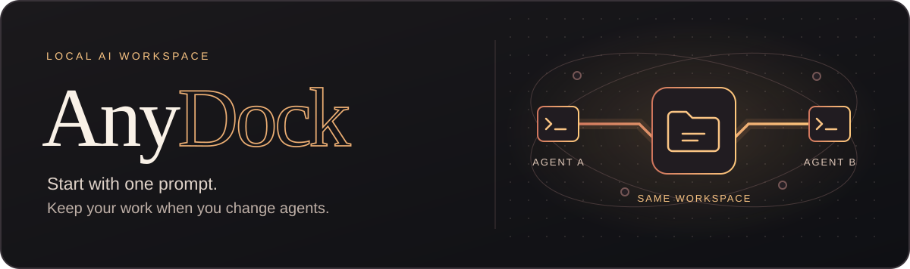

# AnyDock



**Close the chat. Keep the work.**

AnyDock is a local AI workspace you set up with one prompt. Switch models or harnesses, open the same folder, and pick up the exact draft and decision waiting for you. Save an approved correction and carry it into the next run.

[**Get AnyDock**](#get-anydock) · [One-prompt setup](#one-prompt-setup) · [CLI guide](USAGE.md)

## Pick up in a fresh session


Tell the new session, **“Resume the budget review in this folder.”** It finds `summary.md`, the exact revision, and the decision still waiting for you. **Are these budget figures correct?** [Run the worked example](docs/example.md).

## Persistent memory you can edit

- **Pick up the work.** The brief, source snapshots, drafts, and decisions stay in the workspace. A fresh session can see what finished, what changed, and what's waiting.
- **Keep the correction.** Suppose you ask for the approved total on the first line. Save the workflow and confirm that instruction as editable Markdown. The next budget run brings it along.
- **Keep work you've already reviewed.** When a recurring input changes, the managed workflow can carry forward the unchanged results and their approvals. Review the work affected by the change.

## One-prompt setup

Open AnyDock in your agent and start with one file you already have.

```text
Use AnyDock to [your task] with [your file].
Start now, write an editable draft, and stop for my review.
```

<details>
<summary>Bring in an existing project, documents, skills, or agent definitions</summary>

```text
Set up AnyDock at [local folder] for [what I want to use it for].
Bring in [documents, projects, skills or agent definitions and their paths].

Use the AnyDock folder I opened or the package I provide. Verify a release
archive against its SHA-256 checksum before extracting it.
For an existing project, run the packaged CLI with -C "<project folder>" init.
Read AGENTS.md and preserve any existing project instructions.

Copy only the named material. Preserve originals unless I ask you to move
them. Keep projects and their Git metadata together. Keep imported work out
of AnyDock's Git history. Activate only the skills or agents I name.

Set up the features I asked for. Leave the workspace idle and the daily
brief disabled unless I ask for it. Run check from the workspace root if
the CLI is available. Tell me where everything went, which mode is active,
and what to say in a fresh session to continue.
```

</details>

The optional daily brief can collect local feeds, recent work, and pending decisions in one Markdown file. [Configure the daily brief](USAGE.md#daily-brief).

## Why Rust?

**Editable memory. Exact approvals. One local Rust binary.**

Your agent does the work. The Rust CLI owns the run transitions, so the same rules apply when the agent changes.

- **Approval follows the revision.** Edit a reviewed draft and AnyDock requires a decision on the new revision. The earlier output stays in history.
- **Run updates are serialized.** If two sessions advance the same run, the CLI takes a lock and checks state before each update.
- **The next session can recover.** State is committed atomically, and confirmed outputs and decisions stay available on disk.

## Get AnyDock

[**Download the v0.2.0 source ZIP**](https://github.com/skigsy/AnyDock/archive/refs/tags/v0.2.0.zip) · [Release downloads](https://github.com/skigsy/AnyDock/releases)

Extract the ZIP and open its root in an agent that can read and edit local files. It starts empty and idle. The source workspace runs in agent-only mode through [AGENTS.md](AGENTS.md). Use the Rust CLI for managed review gates and recovery.

Build locally with Rust 1.89 or newer and your platform linker.

```sh
cargo build --locked --release
```

Or use the platform executable in a release archive when available. The archive opens to a single versioned folder. Open that folder and run the check from its root.

| Platform | Check |
| --- | --- |
| Windows x64 | `.\bin\anydock.exe check` |
| Linux x64 | `./bin/anydock check` |
| macOS ARM64 | `./bin/anydock check` |

Inputs, outputs, workflows, and run state are ignored by Git by default. The AnyDock CLI reads and writes local files. Your agent handles model calls under its own settings.

[CLI and workspace guide](USAGE.md) · [MIT license](LICENSE)
