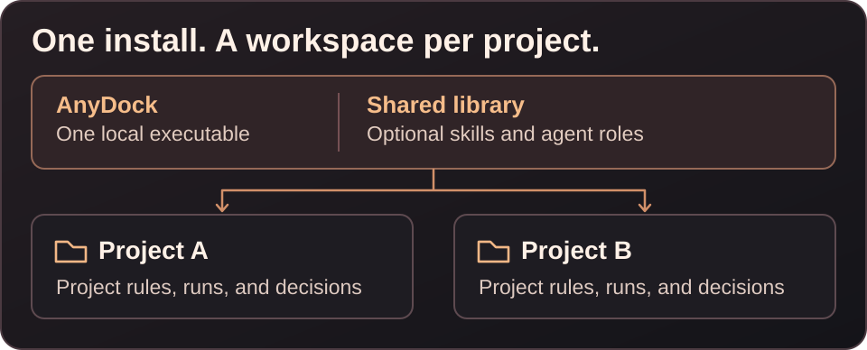

# AnyDock

**Pick up AI work where you left off.**

You open a new chat to finish a project. The files are still there. Which draft was ready? What did you approve? What was the agent supposed to do next?

AnyDock is a small local workspace that saves the task, current files, and pending decisions alongside your project. Open the same folder in another session or agent and tell it to continue.

[**Start with one prompt**](#one-prompt-setup) · [See a real handoff](#see-a-real-handoff) · [Download](#get-anydock)


## One-prompt setup

Open an existing project folder in your agent and give it this prompt.

```text
Get AnyDock 0.2.1 or later from https://github.com/skigsy/AnyDock/releases.
Verify the release checksum, then set it up in this project for future work.
Start with [the work you want done].
```

Your agent checks the release checksum, sets up AnyDock, and adds its workflow to the project's `AGENTS.md`. Your existing instructions stay in place. After that, describe the work as usual. The agent starts or resumes the run, saves a checkpoint when it pauses, and leaves a handoff for the next session.

### Set up a folder of projects

Open the folder that holds your projects and give your agent this prompt.

```text
Get AnyDock 0.2.1 or later from https://github.com/skigsy/AnyDock/releases.
Verify the release checksum. Set it up for this folder's existing and future projects.
```

It runs `anydock setup --projects` once. Existing projects get their own workspace. Codex and Antigravity can set up new projects on first use when they have terminal and file access. All projects share one AnyDock executable. [Setup details](USAGE.md#install-in-a-new-workspace).



## See a real handoff

An agent writes a budget summary and stops for review. In a fresh chat, you say **“Resume the budget review in this folder.”** AnyDock gives the agent `summary.md`, the same revision, and the decision still waiting for you.


If someone edits the reviewed draft, the new revision needs its own approval. The earlier draft and decision remain in the run history. [Run the budget example](docs/example.md).

## Keep the workspace small and portable

- **One binary and local files.** A new workspace starts empty. A run stores the brief, selected inputs, outputs, and decisions for that task. Run files are ignored by Git by default.
- **Change agents when you want.** Project rules live in `AGENTS.md`. Skills use `SKILL.md` and roles use Markdown. An agent that can read the folder can use those same definitions. Projects can share a library or keep their own versions. [Skills and agent roles](USAGE.md#skills-and-agent-roles).
- **Keep what you learned.** Save an approved correction as editable guidance for the next run. When new inputs arrive, a managed workflow can retain results and approvals whose declared inputs still match. [Reuse a workflow](USAGE.md#make-the-next-run-better).

Your agent supplies the model. The Rust executable checks files, records run state locally, and ties review decisions to exact revisions.

## Where it fits

| What you already use | It gives you | What AnyDock adds |
| --- | --- | --- |
| Chat history | The conversation you had | The current draft, what was verified, and the next action |
| `AGENTS.md` | Standing instructions for working in the project | A record of where the current task stopped |
| Git | A history of committed changes | The draft revision awaiting review and the decision tied to it |

<details>
<summary>Bring in an existing project, documents, skills, or agent definitions</summary>

```text
Set up AnyDock at [local folder] for [what I want to use it for].
Bring in only [the documents, projects, skills or roles I name, with their paths].
Preserve the originals, Git history, and existing project instructions.
Verify any downloaded release against its SHA-256 checksum.
Activate only the skills or roles I name. Leave the workspace idle until I give it work.
Run anydock check and tell me how to continue in a fresh session.
```

</details>

The optional [daily brief](USAGE.md#daily-brief) brings local feeds, recent work, and pending decisions into one Markdown file.

## Get AnyDock

[Release downloads](https://github.com/skigsy/AnyDock/releases) · [Source ZIP](https://github.com/skigsy/AnyDock/archive/refs/heads/main.zip) · [CLI guide](USAGE.md) · [MIT license](LICENSE)

Extract a release archive and open its root to start with an empty workspace. Use the bundled executable for managed runs, review gates, and recovery.

| Platform | Check the extracted workspace |
| --- | --- |
| Windows x64 | `.\bin\anydock.exe check` |
| Linux x64 | `./bin/anydock check` |
| macOS ARM64 | `./bin/anydock check` |

To build from source, use Rust 1.89 or later and your platform linker.

```sh
cargo build --locked --release
```
