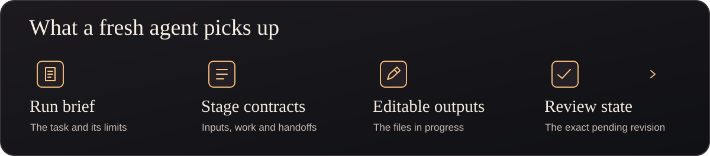

# AnyDock


**Close the chat. Keep the work.**

AnyDock is a local AI workspace you set up with one prompt. Switch models or harnesses, open the same folder, and pick up the exact draft and decision waiting for you. Save an approved correction and carry it into the next run.

[**Get AnyDock**](#get-anydock) · [One-prompt setup](#one-prompt-setup) · [CLI guide](USAGE.md)

## Pick up in a fresh session



Tell the new session, **“Resume the budget review in this folder.”** It finds `summary.md`, the exact revision, and the decision still waiting for you. **Are these budget figures correct?** [Run the worked example](docs/example.md).

## Persistent memory you can edit

- **Pick up the work.** The brief, source snapshots, drafts, and decisions stay in the workspace. A fresh session can see what finished, what changed, and what's waiting.
- **Keep the correction.** Suppose you ask for the approved total on the first line. Save the workflow and confirm that instruction as editable Markdown. The next budget run brings it along.
- **Keep work you've already reviewed.** When a recurring input changes, the managed workflow can carry forward the unchanged results and their approvals. Review the work affected by the change.

## One-prompt setup

Open your project in your agent and say:

```text
Get AnyDock from https://github.com/skigsy/AnyDock/releases.
Set up AnyDock in this project and use it for project work going forward.
Start with [the work you want done].
```

The agent finds the package for your platform, verifies it against the release checksum, and extracts it to a stable local folder. It runs `anydock -C <project> setup` using the verified executable. Setup preserves the existing project rules, adds the AnyDock workflow to `AGENTS.md`, and keeps the workspace idle until you give it work. If the agent uses a different startup filename, it connects that file to `AGENTS.md` during setup. If a project already uses a folder name AnyDock needs, setup keeps its records in `.anydock-work`.

After setup, just describe the work. The agent picks up the current run or starts one, checkpoints when pausing, and records the verified handoff. Ask it to stop for review when you want to make a decision before work continues.

### Set up a folder of projects

Open the folder that contains your projects and say:

```text
Get AnyDock from https://github.com/skigsy/AnyDock/releases.
Set it up for the projects in this folder and use it for new projects here too.
```

The agent runs `anydock -C <projects-folder> setup --projects` once. It configures existing project folders and adds a rule scoped to this folder in installed Codex and Antigravity profiles. When you ask one of those agents to work on a new project here, it handles setup on first use if it can run the CLI and write to the project. Every project has its own runs and review state. They share the same verified executable.

If the terminal cannot write, an agent with native file-editing access can finish the task and leave a private handoff for the next session. The managed workspace can initialize when terminal writes are available.

Projects share skills and agent roles from folders you own. Keep the definitions in the shared library or with the project and `AGENTS.md` tells the agent where to find them. Tell your agent what to do. It can read the relevant skill or role directly from the source. [Where skills and roles live](USAGE.md#skills-and-agent-roles).

<details>
<summary>Bring in an existing project, documents, skills, or agent definitions</summary>

```text
Set up AnyDock at [local folder] for [what I want to use it for].
Bring in [documents, projects, skills or agent definitions and their paths].

Use the AnyDock folder I opened or the package I provide. Verify a release
archive against its SHA-256 checksum before extracting it.
For an existing project, run the packaged CLI with -C "<project folder>" setup.
Read AGENTS.md and preserve any existing project instructions.

Copy only the named material. Preserve originals unless I ask you to move
them. Keep projects and their Git metadata together. Keep imported work out
of AnyDock's Git history. Activate only the skills or agents I name.

Set up the features I asked for. Leave the workspace idle and the daily
brief disabled unless I ask for it. Run check from the workspace root if
the CLI is available. Tell me where everything went, which mode is active,
and what to say in a fresh session to continue.
```

</details>

The optional daily brief can collect local feeds, recent work, and pending decisions in one Markdown file. [Configure the daily brief](USAGE.md#daily-brief).

## Why Rust?

**Editable memory. Exact approvals. One local Rust binary.**

Your agent does the work. The Rust CLI owns the run transitions, so the same rules apply when the agent changes.

- **Approval follows the revision.** Edit a reviewed draft and AnyDock requires a decision on the new revision. The earlier output stays in history.
- **Run updates are serialized.** If two sessions advance the same run, the CLI takes a lock and checks state before each update.
- **The next session can recover.** State is committed atomically, and confirmed outputs and decisions stay available on disk.

## Get AnyDock

[**Release downloads**](https://github.com/skigsy/AnyDock/releases/latest) · [Source ZIP](https://github.com/skigsy/AnyDock/archive/refs/heads/main.zip)

Extract the ZIP and open its root in an agent that can read and edit local files. It starts empty and idle. The source workspace runs in agent-only mode through [AGENTS.md](AGENTS.md). Use the Rust CLI for managed review gates and recovery.

Build locally with Rust 1.89 or newer and your platform linker.

```sh
cargo build --locked --release
```

Or use the platform executable in a release archive when available. The archive opens to a single versioned folder. Open that folder and run the check from its root.

| Platform | Check |
| --- | --- |
| Windows x64 | `.\bin\anydock.exe check` |
| Linux x64 | `./bin/anydock check` |
| macOS ARM64 | `./bin/anydock check` |

Inputs, outputs, workflows, and run state are ignored by Git by default. The AnyDock CLI reads and writes local files. Your agent handles model calls under its own settings.

[CLI and workspace guide](USAGE.md) · [MIT license](LICENSE)
